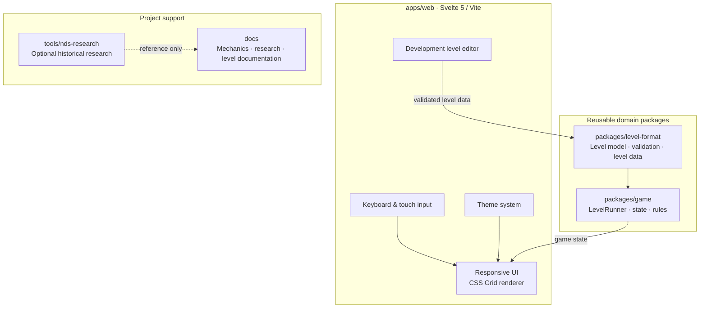

# Duality Olaf

[](https://github.com/flofy/duality-olaf/actions/workflows/ci.yml)
[](https://www.typescriptlang.org/)
[](https://svelte.dev/)
[](https://pnpm.io/workspaces)

**[▶ Play Duality Olaf](https://flofy.github.io/duality-olaf/)** · [Source code](https://github.com/flofy/duality-olaf)

A modern, independent TypeScript reimplementation of the two-form puzzle mechanics inspired by **Olaf / Le Touti Rikiki, Maousse Costo** and the later **Maouss DS** adaptation.

> **Project status:** playable puzzle game · 55-level campaign · seasonal events · active development

## Overview

Duality Olaf explores how a classic grid-based puzzle can be rebuilt with a modern, maintainable architecture.

The player switches between two forms — a ball and a square — to navigate compact levels, interact with obstacles and collect targets. The project combines a framework-independent game engine, a responsive Svelte interface and a data-driven level format.

The goal is to build an original game inspired by the historical mechanics, not to redistribute original binaries or assets.

## Current game

- **55 campaign levels across 5 worlds**, with sequential world unlocking and a deliberate introduction of mechanics.
- A framework-independent **TypeScript game engine** built around `LevelRunner`, with movement, collisions, form switching, targets, doors, switches and teleporters.
- **LevelValidator and LevelSolver** to validate level structure and solvability.
- **Svelte 5 + Vite** web application with responsive CSS Grid gameplay, keyboard and touch controls.
- Guided tutorials integrated into real campaign levels.
- **Challenge Mode** with deterministic, replayable challenges across several mechanic profiles.
- Seasonal Halloween content, with dedicated levels and character forms.
- **Level Lab / Level Builder** for authoring and validating custom levels.
- Theme system, audio ambience, movement feedback and a PWA-oriented static build.
- GitHub Pages deployment workflow, with live availability still to be verified.

A 24-level winter world and Advent calendar are currently proposed in [PR #185](https://github.com/flofy/duality-olaf/pull/185); they are not counted as shipped content until that PR is merged.

## Architecture

The repository is organised as a pnpm workspace. The game rules and level domain are kept separate from the Svelte application so they can evolve and be tested independently.



## Key decisions

### A framework-independent game engine

The rules engine is deliberately independent from Svelte and from rendering libraries such as Phaser. Movement, collision, form switching and completion rules belong to the game domain — not to the UI.

This keeps the core easier to test, makes the renderer replaceable and avoids coupling gameplay to a particular game framework. The current Svelte application is a presentation layer that consumes game state.

### pnpm workspaces for clear boundaries

The monorepo uses pnpm workspaces to separate the web application from reusable domain packages. This gives each package a clear responsibility while keeping local development, dependency management and cross-package changes straightforward.

The level tooling and optional historical research remain outside the runtime application, keeping content authoring and reverse-engineering concerns independent from the player experience.

### Data-driven levels and optional historical research

Levels are represented through a dedicated domain format rather than being embedded in rendering code. This makes them easier to validate, edit and eventually import in batches.

Historical CPC and NDS research informs the mechanics and level model, but reverse-engineering remains optional: the game can progress using original, normalized level data without depending on historical binaries.

## Level research

The current working hypothesis is **55 levels, arranged as 5 worlds × 11 levels**, with a candidate DS map representation of **13 × 10 cells** per level. The visual study is documented in [`docs/assets/levels-overview.svg`](docs/assets/levels-overview.svg).

The historical CPC format is documented separately and can be used as a reference or conversion source. Original binaries remain outside the runtime and are not redistributed.

## Level editing workflow

The Level Lab / Builder is available from the development tools. It uses the same data-driven level model and validation rules as the game runtime. Custom-level persistence, import/export and sharing are tracked separately in [issue #71](https://github.com/flofy/duality-olaf/issues/71).

To save levels directly into `packages/level-format/levels/world-0N/`, start the local write server in a second terminal:

```sh
pnpm level:serve   # http://localhost:34761 — POST /api/save-level
```

Then use **⬇ ÉCRIRE SUR LE DISQUE** in the editor. Levels are validated with the same rules as `level-intake.mjs` before being written. Existing IDs are updated in place; new IDs are appended after the last level of the target world. The target URL can be overridden with `VITE_LEVEL_SERVER_URL`.

## Play online

The production build is configured for GitHub Pages:

**[▶ Play Duality Olaf](https://flofy.github.io/duality-olaf/)**

The deployment is handled by [`.github/workflows/pages.yml`](.github/workflows/pages.yml). The Pages URL is included here as the intended public demo entry point; its live availability should be confirmed after the next successful deployment.

## Development

Requirements: Node.js 24 and pnpm 10.

```sh
pnpm install
pnpm dev
```

Useful quality checks:

```sh
pnpm knip
pnpm test:coverage
pnpm typecheck
pnpm test
pnpm build
```

The CI workflow runs these checks on pull requests and pushes to `main`.

## Roadmap

### Shipped

- [x] Independent TypeScript game domain and framework-independent runtime.
- [x] Complete 55-level campaign across five worlds.
- [x] Gameplay mechanics including form switching, obstacles, doors, switches and teleporters.
- [x] Level validation and solver-backed solvability checks.
- [x] Sequential world progression and guided campaign tutorials.
- [x] Challenge Mode with seeded, replayable challenges.
- [x] Level Lab / Builder for internal content creation.
- [x] Seasonal Halloween levels and character themes.
- [x] Svelte 5 application, responsive controls, shared UI system and PWA build pipeline.

### In progress

- [ ] Immersive full-screen gameplay and world transitions ([PR #182](https://github.com/flofy/duality-olaf/pull/182)).
- [ ] Winter seasonal world and Advent calendar ([PR #185](https://github.com/flofy/duality-olaf/pull/185)).

### Next

- [ ] Add local persistence, import/export and sharing for custom levels ([issue #71](https://github.com/flofy/duality-olaf/issues/71)).
- [ ] Verify the production GitHub Pages deployment and end-to-end player journey.
- [ ] Complete a focused accessibility, responsive-layout and performance review.
- [ ] Finalise release documentation and the v1.0 quality gate ([issue #74](https://github.com/flofy/duality-olaf/issues/74)).
- [ ] Revisit product and monetization decisions only after real player-retention signals ([issue #73](https://github.com/flofy/duality-olaf/issues/73)).

The checklist in [issue #74](https://github.com/flofy/duality-olaf/issues/74) is the release gate; this README roadmap is a high-level overview, not a duplicate task tracker.

## Reference and rights

This project is inspired by historical releases. Original assets, binaries and copyrighted material are treated as reference material only and are not redistributed in this repository. The implementation uses its own code and level data.

## License

Original project code and materials are released under the [MIT License](LICENSE). The copyright and permission notice must be preserved in copies and substantial portions, including forks.

Third-party names, trademarks, artwork, scans, screenshots, binaries, music and other copyrighted materials are excluded from this license and remain subject to their respective owners' rights. See [NOTICE.md](NOTICE.md) for the scope of the license.
