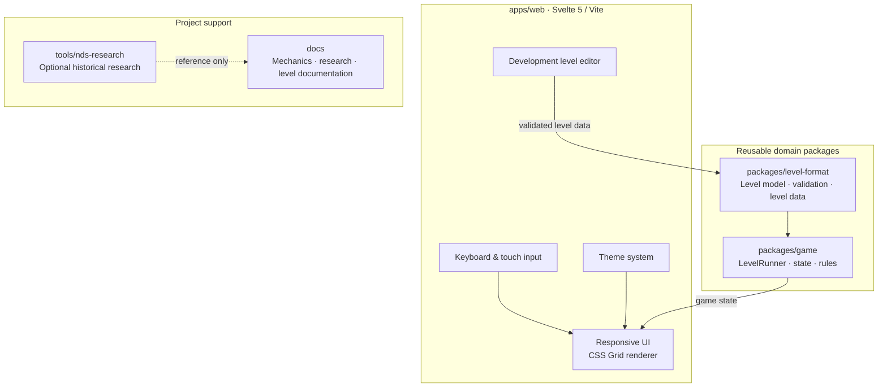

# Duality Olaf

[](https://github.com/flofy/duality-olaf/actions/workflows/ci.yml)
[](https://www.typescriptlang.org/)
[](https://svelte.dev/)
[](https://pnpm.io/workspaces)

**[▶ Play Duality Olaf](https://flofy.github.io/duality-olaf/)** · [Source code](https://github.com/flofy/duality-olaf)

A modern, independent TypeScript reimplementation of the two-form puzzle mechanics inspired by **Olaf / Le Touti Rikiki, Maousse Costo** and the later **Maouss DS** adaptation.

> **Project status:** playable prototype · 11 levels · active development

## Overview

Duality Olaf explores how a classic grid-based puzzle can be rebuilt with a modern, maintainable architecture.

The player switches between two forms — a ball and a square — to navigate compact levels, interact with obstacles and collect targets. The project combines a framework-independent game engine, a responsive Svelte interface and a data-driven level format.

The goal is to build an original game inspired by the historical mechanics, not to redistribute original binaries or assets.

## Current prototype

- **TypeScript game engine** with a framework-independent `LevelRunner` for movement, collisions, form switching, targets and level completion.
- **Svelte 5 + Vite** web application with a responsive CSS Grid renderer.
- **11 playable prototype levels** in the first campaign world, with the planned 5 × 11 world/level structure visible in the level selector.
- Keyboard and touch controls, restart, level completion and next-level flow.
- **Theme system independent from CSS**, with three presets (Rétro, Crépuscule and Océan), switchable from the level menu and persisted locally.
- Development level editor and validation workflow.
- Static production build designed for GitHub Pages and Cloudflare Pages.

## Architecture

The repository is organised as a pnpm workspace. The game rules and level domain are kept separate from the Svelte application so they can evolve and be tested independently.



## Key decisions

### A framework-independent game engine

The rules engine is deliberately independent from Svelte and from rendering libraries such as Phaser. Movement, collision, form switching and completion rules belong to the game domain — not to the UI.

This keeps the core easier to test, makes the renderer replaceable and avoids coupling gameplay to a particular game framework. The current Svelte application is a presentation layer that consumes game state.

### pnpm workspaces for clear boundaries

The monorepo uses pnpm workspaces to separate the web application from reusable domain packages. This gives each package a clear responsibility while keeping local development, dependency management and cross-package changes straightforward.

It also leaves room for future tools — such as level conversion, validation or a standalone editor — without placing them inside the runtime application.

### Data-driven levels and optional historical research

Levels are represented through a dedicated domain format rather than being embedded in rendering code. This makes them easier to validate, edit and eventually import in batches.

Historical CPC and NDS research informs the mechanics and level model, but reverse-engineering remains optional: the game can progress using original, normalized level data without depending on historical binaries.

## Level research

The current working hypothesis is **55 levels, arranged as 5 worlds × 11 levels**, with a candidate DS map representation of **13 × 10 cells** per level. The visual study is documented in [`docs/assets/levels-overview.svg`](docs/assets/levels-overview.svg).

The historical CPC format is documented separately and can be used as a reference or conversion source. Original binaries remain outside the runtime and are not redistributed.

## Level editing workflow

The development-only editor is available at `/dev/editor` (with the devtools flag enabled).

To save levels directly into `packages/level-format/levels/world-0N/`, start the local write server in a second terminal:

```sh
pnpm level:serve   # http://localhost:34761 — POST /api/save-level
```

Then use **⬇ ÉCRIRE SUR LE DISQUE** in the editor. Levels are validated with the same rules as `level-intake.mjs` before being written. Existing IDs are updated in place; new IDs are appended after the last level of the target world. The target URL can be overridden with `VITE_LEVEL_SERVER_URL`.

## Play online

The production build is configured for GitHub Pages:

**[▶ Play Duality Olaf](https://flofy.github.io/duality-olaf/)**

The deployment is handled by [`.github/workflows/pages.yml`](.github/workflows/pages.yml). The Pages URL is included here as the intended public demo entry point; its live availability should be confirmed after the next successful deployment.

## Development

Requirements: Node.js 24 and pnpm 10.

```sh
pnpm install
pnpm dev
```

Useful quality checks:

```sh
pnpm knip
pnpm test:coverage
pnpm typecheck
pnpm test
pnpm build
```

The CI workflow runs these checks on pull requests and pushes to `main`.

## Roadmap

- [x] Establish the independent TypeScript domain model.
- [x] Introduce a framework-independent `LevelRunner`.
- [x] Connect the prototype to a responsive Svelte/CSS renderer.
- [x] Add keyboard and initial touch controls.
- [x] Add the first 11-level prototype campaign and level selection.
- [x] Add CI typecheck/build validation.
- [ ] Stabilize movement and collision rules against historical gameplay.
- [ ] Define and import the normalized 55-level catalogue.
- [ ] Add progression and save state.
- [ ] Add PWA install/offline support.
- [ ] Verify the public GitHub Pages deployment.
- [ ] Develop the original visual identity and expand the level editor.

## Reference and rights

This project is inspired by historical releases. Original assets, binaries and copyrighted material are treated as reference material only and are not redistributed in this repository. The implementation uses its own code and level data.

## License

A license for the new code and original assets has not been selected yet. The repository's licensing terms should be clarified before presenting the project as an openly reusable release.
